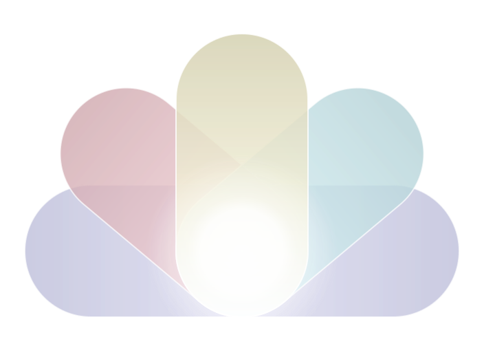
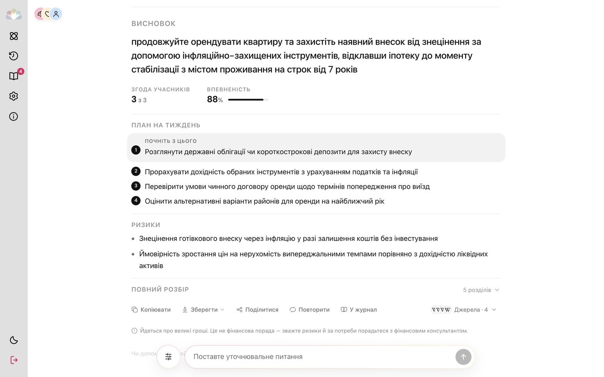
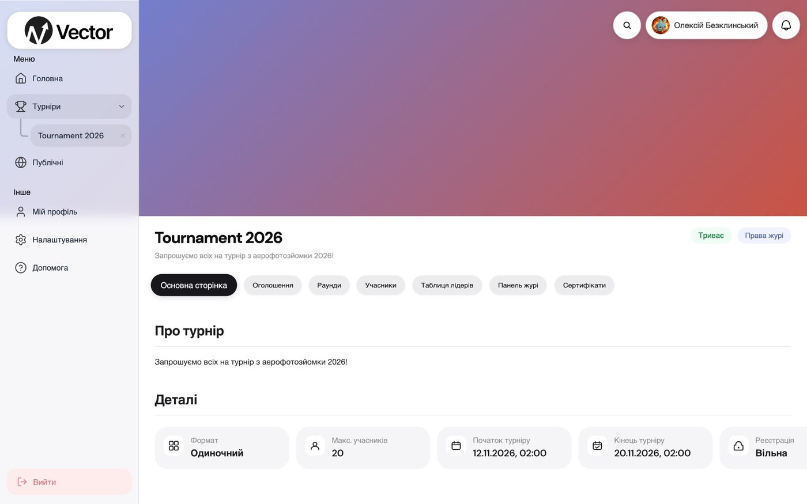
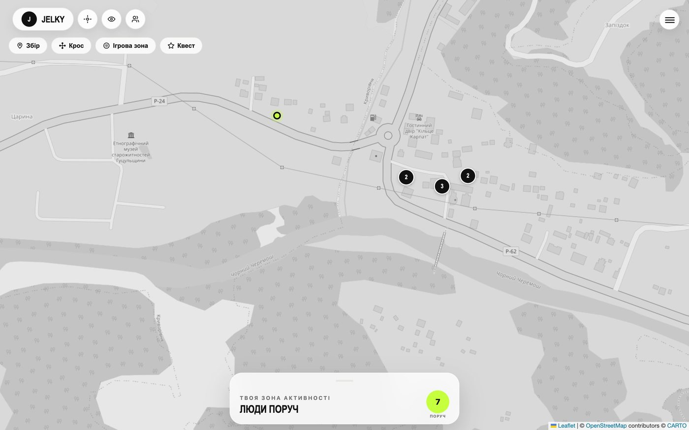
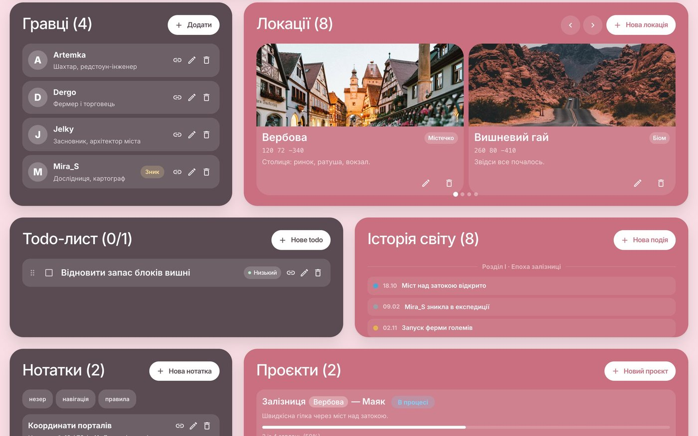
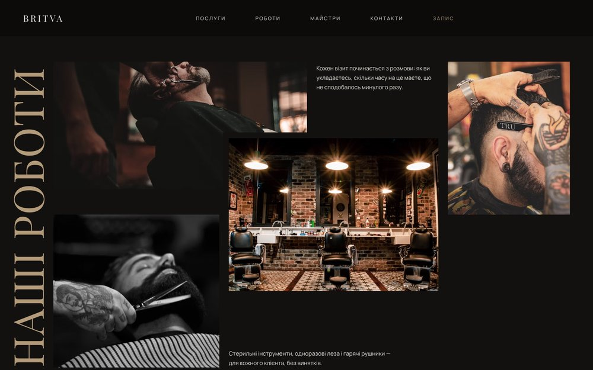
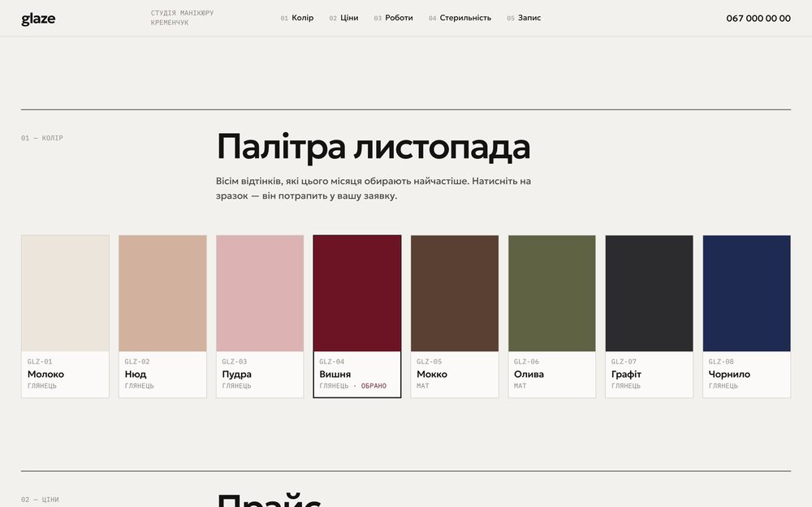

# Hi, I'm Oleksii 👋

**Full-stack developer & designer from Kremenchuk, Ukraine 🇺🇦**

I take products from idea to launch: concept, logo and interface, architecture, most of the code — and I lead the team that builds it.
I also design and build websites for local businesses.

---

## Highlights

- 🥉 **3rd place, All-Ukrainian Team Programming Tournament 2026** (Star for Life Ukraine, Junior Academy of Sciences of Ukraine) — 121 teams at the start; with **Vector** we made the top 4 and the final, where we built **Scalaris** in 5 days
- 🧑‍✈️ Team lead on Vector, Scalaris and WorldLog
- 🎨 I design my own interfaces, logos and brand identity
- 🏅 Prize winner in maths and English olympiads, year after year

---

## Featured projects

<table>
<tr>
<td colspan="2" valign="top">

### [Clarity — an AI council for hard decisions](https://ttjelky.github.io/portfolio/en/work/clarity/)

Several AI participants with different personalities debate your question, a moderator turns the arguments into a decision and an AI Devil hunts for its weak spots. You get a verdict with pros, risks and a next step. A Django state machine runs the debate; 9 model providers, web search, attachments, a decision journal, UA/EN.

**[🌐 Live](https://clarity-three-xi.vercel.app/)** · **My role:** idea, logo, all of the code and architecture, final design · 450+ backend tests

`Django` `DRF` `React 19` `PostgreSQL` `Docker` `LLM APIs`

</td>
</tr>
<tr>
<td width="50%" valign="top">

### [Vector — tournament platform](https://github.com/ttjelky/vector)

Run academic tournaments in any subject — individual or team format — with rounds, jury, a live leaderboard and automatic PDF certificates.

🏁 Top 4 of 121 teams — reached the tournament final.

**My role:** team lead of three, ~70% of the code, all design and the logo

`Django` `DRF` `Channels` `React 19` `JWT`

</td>
<td width="50%" valign="top">

### [Scalaris — social activity map](https://github.com/ttjelky/Scalaris)

A mobile-first map of people nearby who are up for something right now: meetups, runs with checkpoints, game zones and quests, all in real time.

🥉 3rd place at the final — built in 5 days.

**My role:** team lead, ~50% of the code, design, logo and technical decisions

`Django Channels` `PostGIS` `Redis` `React 19` `Leaflet`

</td>
</tr>
<tr>
<td colspan="2" valign="top">

### [WorldLog — a passport for a Minecraft world](https://github.com/ttjelky/Worldlog) · *in development*

A shared journal for a game world: players, locations with coordinates, tasks and projects, a timeline in eras, a linked wiki and a D3 relationship graph, 9 biome themes. Open source.

**My role:** idea, ~90% of the code, design and identity, leading one teammate (team DiJital)

`Django` `DRF` `React 19` `MUI` `TanStack Query` `D3`

</td>
</tr>
</table>

### Websites for local businesses

| [BRITVA — barbershop](https://ttjelky.github.io/barbershop-landing/) | [glaze — nail studio](https://ttjelky.github.io/nail-studio-landing/) |
|:-:|:-:|
|  |  |

Concepts designed and built from scratch, no frameworks. Need a site for your business? [Let's talk](https://t.me/ttjelky).

---

## Tech stack

-3178C6?style=flat-square&logo=typescript&logoColor=white)

---

📫 [Portfolio](https://ttjelky.github.io/portfolio/) · [LinkedIn](https://www.linkedin.com/in/olexiy-bezklynskiy-694a243b5/) · [Telegram](https://t.me/ttjelky) · [bezklinskiyalexey@gmail.com](mailto:bezklinskiyalexey@gmail.com)

